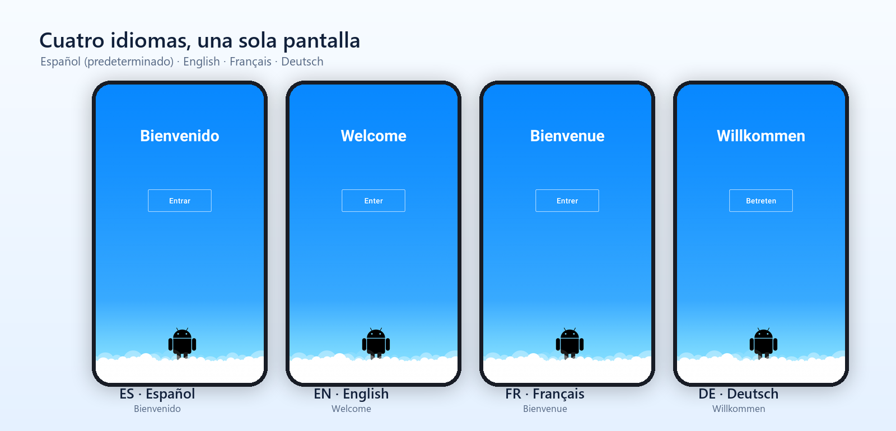
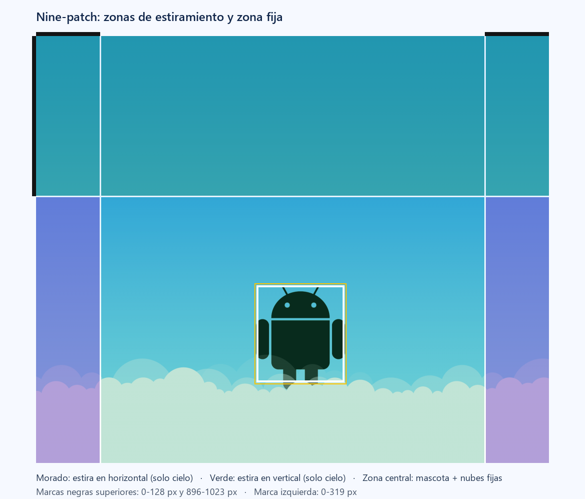
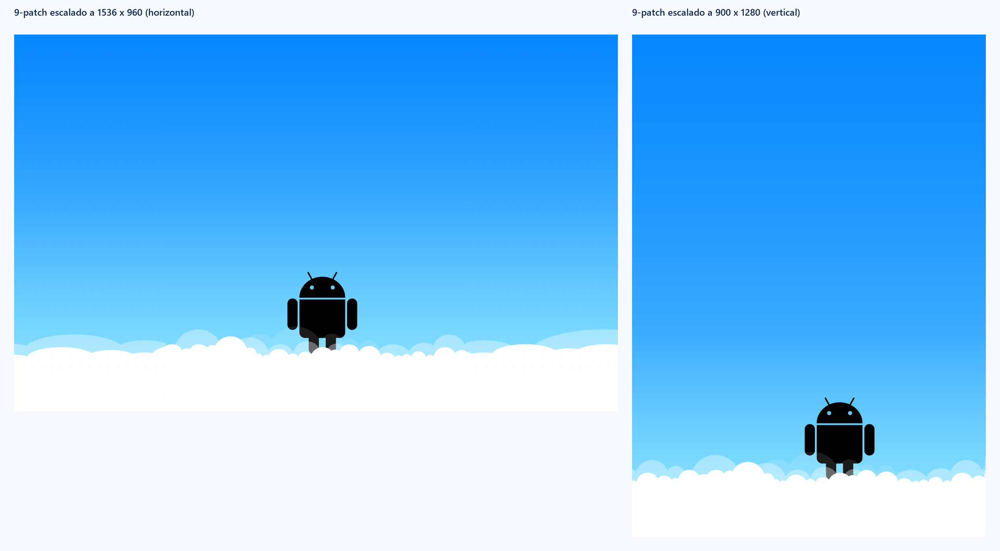
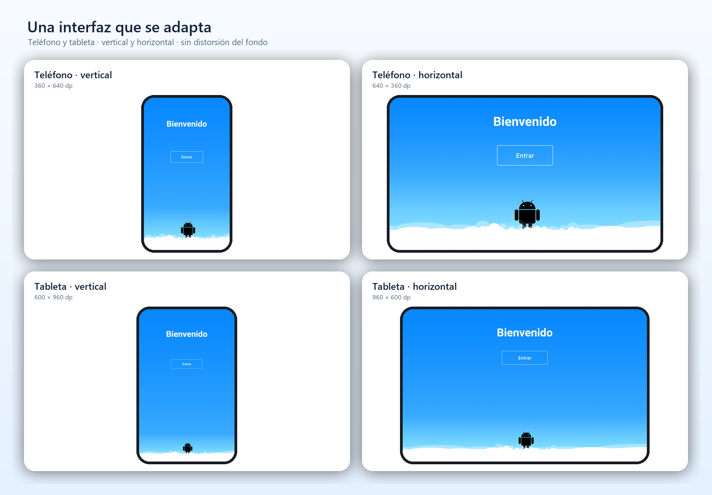
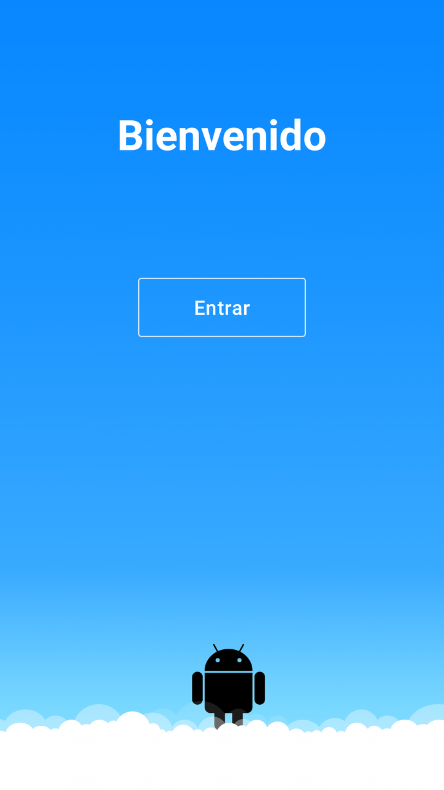
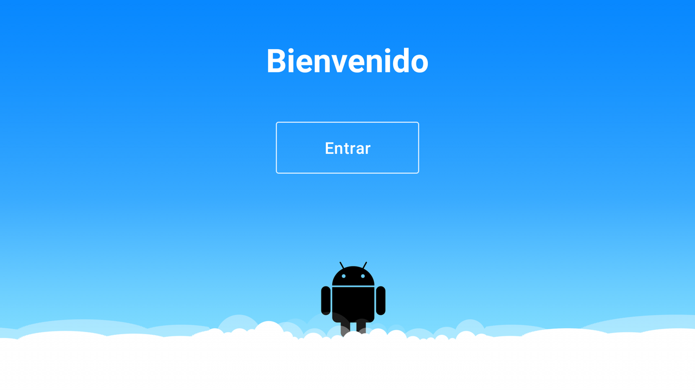
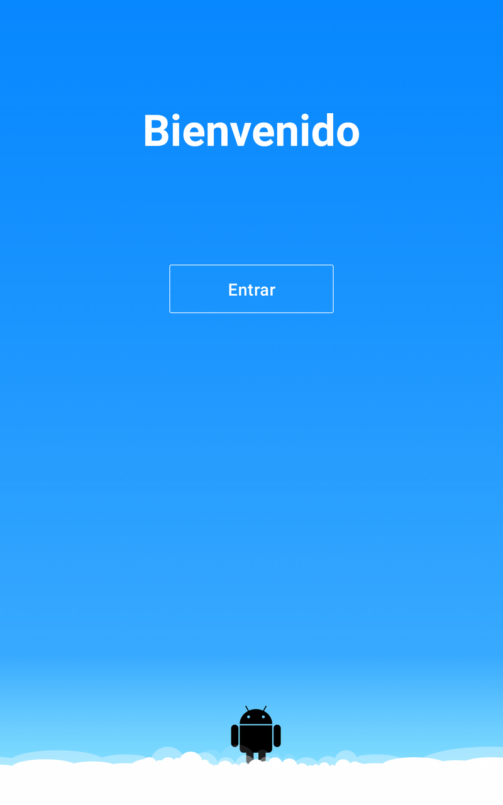
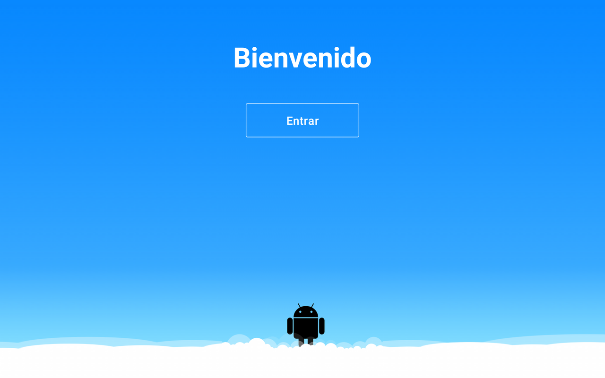

# MiPrimerProyectoAndroid

Pantalla de bienvenida para el primer proyecto Android: fondo ilustrado con la mascota de
Android, cuatro idiomas y un diseño que se adapta a teléfonos y tabletas en vertical y
horizontal.

Repositorio: <https://github.com/Korvantdev/MiPrimerProyectoAndroid>



## Requisitos del proyecto

| Requisito | Implementación |
| --- | --- |
| Español como idioma predeterminado | Recursos base en `app/src/main/res/values/` |
| Inglés, francés y alemán | `values-en/`, `values-fr/`, `values-de/` |
| Fondo nine-patch redimensionable | `app/src/main/res/drawable-xxhdpi/background.9.png` |
| La mascota no se deforma | Zona central fija del nine-patch; solo se estira el cielo |
| Múltiples tamaños y orientaciones | `ConstraintLayout`, `dp`/`sp`, `values-land`, `values-sw600dp` y `values-sw600dp-land` |
| GitHub | Repositorio Git con rama de trabajo, fusión y guía de publicación |

## Idiomas

| Idioma | Saludo | Botón | Código |
| --- | --- | --- | --- |
| Español (predeterminado) | Bienvenido | Entrar | `values/` |
| Inglés | Welcome | Enter | `values-en/` |
| Francés | Bienvenue | Entrer | `values-fr/` |
| Alemán | Willkommen | Betreten | `values-de/` |

La app también declara `res/xml/locales_config.xml`, por lo que Android 13+ muestra los
cuatro idiomas en el selector de idioma por aplicación. Al pulsar **Entrar** se muestra un
mensaje localizado; sirve para comprobar que el botón responde.

## Fondo nine-patch

El archivo `background.9.png` se genera desde `design/background-source.png` con
`tools/prepare_assets.py`. Las marcas negras del nine-patch son deliberadas:

- **Estiramiento horizontal:** solo las columnas de cielo de los extremos, `0-128 px` y
  `896-1023 px`. La zona central de `128-895 px` queda fija y contiene a la mascota.
- **Estiramiento vertical:** solo la franja superior de cielo, `0-319 px`. La mascota y la
  banda de nubes inferior permanecen fijas.
- La caja de protección de la mascota va de `x=440-615` e `y=498-691`; ninguna marca de
  estiramiento la toca.



El resultado al estirar el mismo archivo a formato horizontal y vertical:



El PNG está en `drawable-xxhdpi` para que la zona fija tenga un tamaño físico coherente
entre densidades. El `ConstraintLayout` raíz declara `android:padding="0dp"`: algunas
herramientas calculan un *content padding* para el nine-patch y, sin ese valor explícito,
la interfaz se desplazaría hacia arriba. Los insets de las barras del sistema se aplican
después, en `MainActivity`, sin recortar el fondo.

## Diseño adaptable



- El título y el botón se posicionan con `ConstraintLayout` y *bias* vertical.
- `values/dimens.xml` define tipografía y botón para teléfono vertical.
- `values-land/` reduce el tamaño de letra en horizontal.
- `values-sw600dp/` aumenta tipografía y botón en tabletas.
- `values-sw600dp-land/` combina ambos casos.
- El título usa autoajuste de texto en una línea para que las palabras largas
  (`Willkommen`, `Bienvenue`) no se recorten.
- La actividad no bloquea la orientación ni los cambios de tamaño; al rotar se recrea y
  Android elige los recursos correspondientes.

### Capturas individuales

| Teléfono vertical | Teléfono horizontal |
| --- | --- |
|  |  |

| Tableta vertical | Tableta horizontal |
| --- | --- |
|  |  |

Las capturas son renders del árbol de vistas real con Robolectric, a `360×640 dp`,
`640×360 dp`, `600×960 dp` y `960×600 dp`. Las barras del sistema se omiten en el render
para poder comparar la composición.

## Cómo ejecutar

### Android Studio

1. Abrir Android Studio y seleccionar **Open**.
2. Seleccionar la carpeta `MiPrimerProyectoAndroid`.
3. Esperar la sincronización de Gradle (JDK 17 o superior; el proyecto compila con JDK 21).
4. Ejecutar la configuración `app` en un emulador o dispositivo con Android 5.0+ (API 21+).
5. Para probar los idiomas, cambiar el idioma del sistema o usar **Settings → System →
   Languages & input → App languages → Mi primer proyecto Android**.

### Línea de comandos

```bash
./gradlew assembleDebug
```

En Windows:

```bat
gradlew.bat assembleDebug
```

El APK se genera en:

```text
app/build/outputs/apk/debug/app-debug.apk
```

El proyecto usa `compileSdk 35` y `buildToolsVersion 35.0.0`. Si el SDK local no tiene esas
versiones, Android Studio las instala al sincronizar.

## Pruebas

```bash
./gradlew testDebugUnitTest
```

`MainActivityTest` comprueba, con Robolectric:

- los cuatro idiomas y el mensaje del botón;
- que el fondo sea un `NinePatchDrawable`;
- que título y botón no se solapen en teléfono/tableta y vertical/horizontal;
- que el botón tenga un área táctil mínima de 48 dp;
- que no se recorte el título;
- la generación de las capturas de `docs/screenshots/`.

También se puede ejecutar `./gradlew lintDebug` (0 errores).

## Estructura

```text
MiPrimerProyectoAndroid/
├── app/
│   └── src/
│       ├── main/
│       │   ├── java/com/example/miprimerproyecto/MainActivity.java
│       │   ├── res/
│       │   │   ├── drawable-xxhdpi/background.9.png
│       │   │   ├── layout/activity_main.xml
│       │   │   ├── values/          # español (default)
│       │   │   ├── values-en/
│       │   │   ├── values-fr/
│       │   │   ├── values-de/
│       │   │   ├── values-land/
│       │   │   ├── values-sw600dp/
│       │   │   └── values-sw600dp-land/
│       │   └── AndroidManifest.xml
│       └── test/java/com/example/miprimerproyecto/MainActivityTest.java
├── design/
│   └── background-source.png
├── docs/
│   ├── ninepatch-guide.png
│   ├── preview-languages.png
│   ├── preview-screens.png
│   └── screenshots/
├── tools/
│   ├── prepare_assets.py
│   └── render_docs.py
├── build.gradle
└── settings.gradle
```

## Publicación en GitHub

El proyecto está preparado para publicarse. Desde la raíz del repositorio:

```bash
git remote add origin https://github.com/Korvantdev/MiPrimerProyectoAndroid.git
git push -u origin main
git push origin --all
git push --tags
```

El historial incluye una rama de trabajo y su fusión a `main`, que refleja el flujo de
trabajo utilizado:

1. **Crear el repositorio** en GitHub.
2. **Crear una rama:** `git switch -c feature/pantalla-bienvenida`.
3. **Realizar el commit:** `git add . && git commit -m "Pantalla de bienvenida responsive"`.
4. **Abrir un Pull Request** desde la rama hacia `main`.
5. **Revisar y fusionar** el Pull Request.

Una vez publicado, la URL del repositorio se comparte con los compañeros para la revisión.

## Créditos

- Imagen de fondo y enunciado: material del curso.
- La mascota de Android es una marca de Google; se usa únicamente con fines educativos.
- Tipografía del sistema Android (Roboto).
